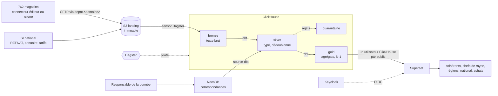
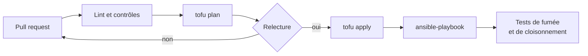

# Architecture cible

!!! abstract "En bref"
    - ClickHouse stocke, transforme et sert les données.
    - Dagster pilote dbt de 23 h à 6 h. Les données sont prêtes à 7 h 30.
    - ClickHouse fixe le plafond de chaque public. Superset filtre par utilisateur à l'intérieur de ce plafond.
    - Tous les publics métier utilisent Superset. Les exploitants ont Grafana, Dagster et SFTPGo. Le responsable de la donnée a NocoDB.
    - Le magasin envoie ses fichiers à `depot.<domaine>`. Vibro ne se connecte jamais au magasin.
    - Deux machines sont visibles depuis Internet : `restitution` et `depot`.
    - OpenTofu crée l'infrastructure, Ansible la configure, SOPS chiffre les secrets.

## Contraintes qui pilotent les choix

| Contrainte | Valeur | Conséquence |
|---|---|---|
| Volume | 34 M lignes par jour, ×2,6 le 24 décembre, 5 ans d'historique | Moteur colonne, stockage froid sur S3 |
| Fenêtre | Traitement de 23 h à 6 h, données prêtes à **7 h 30** | Batch de nuit, publication atomique |
| Cloisonnement | Un adhérent voit son magasin seul. Agrégat publié seulement à partir de **5 magasins** | La base fixe le plafond de chaque public, l'outil filtre par utilisateur, un test vérifie les deux |
| Équipe | 2 personnes pour l'exploitation | Peu de composants, tout en code |
| Hébergement | Données en France ou dans l'UE | Fournisseur cloud français, 2 régions |
| Sobriété | Le client demande une solution mesurée en énergie et en coût | Un moteur, des VM petites, du froid sur S3 |

Sources : [volumétrie](../00-cadrage/reponses-client/volumetrie-et-contraintes.md), [cloisonnement](../00-cadrage/reponses-client/donnees-personnelles-et-cloisonnement.md), [hébergement](../00-cadrage/reponses-client/hebergement-et-securite.md).

## Vue d'ensemble

## Une nuit type

| Heure | Étape | En cas d'échec |
|---|---|---|
| 21 h – 22 h | Les caisses clôturent | — |
| 22 h – 23 h 30 | Les livraisons arrivent par `depot.<domaine>` | Le connecteur réessaie, une alerte part |
| 23 h 30 | Dagster contrôle la complétude | Alerte « magasin absent » |
| 23 h 30 – 6 h | dbt construit silver puis `gold_new` | Dagster relance la partition magasin × jour |
| 6 h | Les tests dbt vérifient volumes, seuil de 5 magasins, étanchéité | La veille reste en ligne avec un bandeau |
| 6 h | `EXCHANGE TABLES` publie `gold_new` d'un seul coup | — |
| **7 h 30** | Les directeurs consultent | — |

## Couches de données

| Couche | Où | Contenu | Règle |
|---|---|---|---|
| **landing** | S3 | Fichier reçu, tel quel | Immuable : versionnement et object lock. Fichier avec données personnelles : 13 mois au plus. Source de rejeu |
| **bronze** | ClickHouse | Colonnes en `String`, plus `_path` et `_file` | Aucune interprétation. Conserve l'encodage d'origine |
| **silver** | ClickHouse | Données typées, dédoublonnées, référentiels appliqués | Rejets en quarantaine avec leur motif |
| **gold** | ClickHouse | CA jour × magasin × rayon, comparaison N-1 | Publié seulement si les tests passent |

**Clé de tri** : `(magasin_id, date)`. Une requête d'un magasin lit environ 1/762 des données.

**Stockage froid** : ClickHouse déplace les données de plus de 13 mois sur S3.

## Ingestion

Le magasin envoie ses fichiers à `depot.<domaine>`. Vibro ne se connecte jamais à un système du magasin. Le détail est dans [Ingestion des sources hétérogènes](ingestion.md).

- Voie 1 : l'éditeur de caisse envoie chaque nuit les tickets et un manifeste. Cette voie vise ~750 magasins.
- Voie 2 : rclone copie le dossier d'export, pour les magasins sans connecteur éditeur.
- La passerelle SFTPGo, sur la VM `depot`, écrit dans le bucket `landing`. Chaque magasin a sa clé SSH.
- Un sensor Dagster contrôle chaque livraison et la charge dans le bronze.
- Le directeur ne fait aucune action. L'alerte va à l'exploitant.

## Cloisonnement

| Acteur | Voit | Ne voit pas |
|---|---|---|
| Adhérent | Son magasin au détail, sa marge | Tout autre magasin |
| Adhérent | Agrégats régionaux et nationaux de 5 magasins ou plus | Un agrégat de moins de 5 magasins |
| Région | Ses magasins au détail | La marge d'un magasin, les autres régions |
| National | Agrégats à toute maille | Un porteur de carte |

**Mécanisme :**

Superset se connecte à ClickHouse avec un compte par connexion. ClickHouse ne voit donc pas l'utilisateur final. La garantie tient en deux étages :

| Étage | Où | Ce qu'il garantit |
|---|---|---|
| Plafond par public | ClickHouse : un utilisateur par connexion Superset, droits `GRANT` par table | Ce qu'un public ne peut jamais lire, même si l'outil se trompe |
| Filtre par utilisateur | Superset : règle RLS sur chaque dataset | Le périmètre de chaque personne dans ce plafond |

| Connexion Superset | Utilisateur ClickHouse | Tables accessibles | Règle RLS Superset |
|---|---|---|---|
| National et achats | `ss_national` | Agrégats de 5 magasins ou plus, sans marge par magasin | Aucune |
| Régions | `ss_region` | Détail par magasin, **sans les tables de marge** | Région de l'utilisateur |
| Adhérents | `ss_adherent` | Détail et marge par magasin, agrégats de 5 magasins ou plus | Magasins de l'utilisateur |

- Keycloak porte l'identité. Superset s'y connecte en OIDC, sans licence. Le rôle Superset vient du groupe Keycloak.
- La règle RLS lit le périmètre dans la base : `magasin_id IN (SELECT magasin_id FROM acces_utilisateur WHERE login = '{{ current_username() }}')`. dbt construit `acces_utilisateur` chaque nuit depuis le registre. Une cession est prise en compte au run suivant.
- SQL Lab, la création de graphiques et l'export CSV sont coupés pour tous les rôles métier. SQL Lab contourne les règles RLS.
- Le login reste dans la clé de cache de Superset (comportement par défaut de `current_username()`).
- Le gold ne contient aucun agrégat de moins de 5 magasins (`HAVING uniq(magasin_id) >= 5`).
- Aucun tableau ne classe des magasins entre eux.
- Un test automatique se connecte à Superset avec un compte de l'adhérent A et vérifie qu'aucune ligne du magasin B ne sort, à chaque livraison.

!!! warning "Règle posée par la direction juridique"
    Aucun affichage comparatif nominatif entre adhérents, quelle que soit la maille.

## Accès par acteur

| Acteur | Outil | Accès | Garantie |
|---|---|---|---|
| Direction nationale, achats | Superset, connexion national | `bi.`, Keycloak | ClickHouse : agrégats seulement |
| Direction régionale | Superset, connexion régions | `bi.`, Keycloak | ClickHouse : pas de marge. Superset : sa région |
| Adhérent, chef de rayon | Superset, connexion adhérents | `bi.`, Keycloak | ClickHouse : tables adhérent. Superset : ses magasins |
| Exploitant | Grafana, Dagster, interface d'administration SFTPGo | `grafana.`, `dagster.`, `depot.`, Keycloak avec MFA | Aucune lecture des données métier hors intervention tracée |
| Responsable de la donnée | NocoDB | `donnees.`, oauth2-proxy (Keycloak avec MFA) puis compte NocoDB | Saisie dans PostgreSQL, historique des modifications |
| SI national | Dépôt SFTPGo, interface web pour un dépôt manuel | `depot.`, une clé ou un compte par source | Écrit seulement sous `landing/national/<source>/` |

- **Dagster** n'a pas d'authentification en version open source. Il passe derrière oauth2-proxy, groupe `exploitant`.
- **NocoDB** Community n'a pas de SSO. Les comptes sont locaux, sur invitation, et oauth2-proxy impose Keycloak avant. Licence Sustainable Use depuis janvier 2026 : l'usage interne auto-hébergé reste gratuit.
- **Comptes des salariés** : l'adhérent ouvre et ferme ceux de son magasin dans Keycloak (administration déléguée, à tester au POC).

## Restitution

- Les indicateurs sont calculés dans les modèles dbt gold. Superset n'ajoute aucun calcul : chaque indicateur a une seule définition.
- Les tableaux de bord sont exportés en YAML et versionnés dans le dépôt.
- Les écrans visent la tablette et le terminal : une colonne, 3 à 5 indicateurs, filtres date, rayon et N-1.
- Les correspondances validées dans NocoDB sont lues par dbt comme une source, au run de la nuit.
- Cube s'ajoute seulement si un deuxième consommateur arrive (application mobile, API, export).

## Infrastructure

| Machine | Rôle | Remarque |
|---|---|---|
| `ch-1` | ClickHouse, avec Keeper intégré | **Nœud unique**. Disque séparé pour Keeper |
| `orchestration` | Dagster et runner CI | Lance OpenTofu et Ansible |
| `restitution` | Traefik, oauth2-proxy, Keycloak, Superset, NocoDB | IP publique, port 443 |
| `depot` | SFTPGo, passerelle de dépôt des magasins | IP publique, ports 22 (SFTP) et 443. Écrit dans `landing` seulement |
| `supervision` | Prometheus, Grafana, Loki | Alertes : magasin absent, rejets, fraîcheur |
| PostgreSQL managé | Métadonnées Dagster, Superset, Keycloak, NocoDB. Base des correspondances | Endpoint privé |
| Buckets S3 | `landing`, `froid`, `backups`, `tofu-state` | `backups` répliqué en région 2 |

**Réseau :**

- Sur Internet, seuls ces ports sont ouverts : 443 sur `restitution`, 22 (SFTP) et 443 sur `depot`.
- Les ports 9440 et 8443 (ClickHouse) restent dans le réseau privé. Keeper n'écoute pas sur le réseau.
- Le SSH d'administration (22) écoute sur l'interface privée seulement. Sur `depot`, le port 22 public est le SFTP de SFTPGo.
- SSH vers les VM part seulement d'`orchestration`, où le runner lance Ansible.

### Diagrammes UML

Les sources sont les fichiers `.drawio` de ce dossier. Modifiez-les dans draw.io : le rendu de cette page suit.

=== "Flux"

    

=== "Déploiement"

    

=== "Infrastructure"

    

=== "Réseau"

    

=== "Gestion"

    

## Gestion de l'infrastructure

- OpenTofu crée les VM, disques, groupes de sécurité, buckets, PostgreSQL et DNS.
- Ansible installe et configure les logiciels. Son inventaire vient des sorties OpenTofu.
- SOPS + age chiffre les secrets dans le dépôt. La clé privée du runner reste sur `orchestration`.
- L'état OpenTofu est dans un bucket dédié, chiffré par OpenTofu.
- Le runner est auto-hébergé dans le réseau privé. Il n'exécute jamais une PR issue d'un fork.
- Chaque nuit, un `tofu plan` vérifie que l'infrastructure n'a pas dérivé.

!!! note "Amorçage"
    Le premier `tofu apply` part du poste d'un exploitant. Il crée le bucket d'état, le réseau et la VM du runner. Ensuite, tout passe par une pull request.

## Sauvegarde

| Élément | Protection | Reprise |
|---|---|---|
| `landing` | Versionnement, object lock | Source de reconstruction de toutes les couches |
| ClickHouse | `clickhouse-backup` vers `backups`, répliqué en région 2 | Restauration, ou rejeu depuis landing |
| PostgreSQL | Sauvegarde du fournisseur avec reprise à un instant donné | Restauration du fournisseur |
| Code, infrastructure, secrets | Git, chiffré par SOPS | Nouveau `tofu apply` puis Ansible |

Objectifs à valider avec le client : **RPO 24 h**, **RTO 4 à 8 h**.

### Pourquoi un seul nœud ClickHouse

Une restauration depuis `backups` tient le RTO. Rejouer 5 ans depuis landing ne le tient pas : ce rejeu sert à corriger une règle, pas à reprendre après une panne.

| Panne | Reprise | Durée estimée |
|---|---|---|
| VM perdue en journée | OpenTofu recrée la VM, Ansible la configure, restauration de la sauvegarde de 6 h | 1 à 2 h, **à mesurer** |
| VM perdue pendant le batch | Restauration de la veille, puis rejeu de la nuit depuis landing | 2 à 4 h. La matinée peut être ratée |

- **Gain** : une VM de données au lieu de trois, plus de quorum ni de réplication à surveiller.
- **Coût** : 1 à 2 h sans tableaux de bord en cas de panne, montées de version la nuit.
- **Assurance** : les tables sont en `ReplicatedMergeTree` avec une seule réplique. Ajouter une 2e réplique demande une VM, pas une migration.

**Passer à 2 répliques si l'un de ces seuils est atteint :**

- la restauration mesurée dépasse 3 h ;
- le nœud fait rater plus d'une matinée par trimestre ;
- la latence p95 au pic de 7 h 30 sort de la cible.

Chronométrer une restauration à chaque incrément, puis chaque trimestre.

## Décisions

| Sujet | Choix | État |
|---|---|---|
| Moteur | ClickHouse, moteur unique | Décidé |
| Haute disponibilité | Un nœud ClickHouse, 2e réplique si un seuil est atteint | Décidé |
| Bronze | Table ClickHouse en `String`, pas de Parquet | Décidé |
| Orchestration | Dagster et dbt-clickhouse | Décidé |
| Restitution | Superset pour tous les publics métier, Cube si un 2e consommateur arrive | Décidé |
| Correspondances | NocoDB sur PostgreSQL, lu par dbt | Décidé |
| Exploitation | Grafana, Dagster, SFTPGo derrière Keycloak et MFA | Décidé |
| Cloisonnement | Utilisateur ClickHouse par public, RLS Superset par utilisateur, seuil de 5 magasins | Décidé |
| Infrastructure | OpenTofu, Ansible, SOPS + age, runner auto-hébergé | Décidé |
| Ingestion | Le magasin envoie. Connecteur éditeur, sinon rclone | **Proposé**, à valider avec les éditeurs |
| Point de dépôt | Passerelle SFTPGo sur `depot.<domaine>`, une clé SSH par magasin | **Proposé** |
| Chargement du bronze | Sensor Dagster par livraison, pas S3Queue | **Proposé** |
| Éditeurs locaux (~12 magasins) | Au cas par cas | **Ouvert** |
| Fournisseur cloud | Français, 2 régions | **Ouvert** |
| Nom de domaine | À définir, enregistré au nom du client. Les noms `depot.`, `bi.`, `auth.`, `donnees.`, `grafana.` et `dagster.` en dépendent | **Ouvert** |

Chaque décision fait l'objet d'une fiche courte : contexte, options, choix, conséquences.

## À valider au POC

| Question | Critère de réussite |
|---|---|
| Le cloisonnement tient-il par toutes les voies (Superset, SQL Lab coupé, export, cache) ? | Zéro fuite |
| La nuit du 24 décembre (×2,6) tient-elle dans la fenêtre ? | Gold publié avant 6 h, avec marge |
| Superset répond-il au pic de 7 h 30 ? | Cible proposée : moins de 2 s par tableau. Nombre d'utilisateurs simultanés à fixer avec le client |
| La règle RLS avec `current_username()` fonctionne-t-elle sur ClickHouse ? | Filtre présent dans chaque requête du `query_log` |
| Superset est-il utilisable debout, sur terminal, au clavier et avec NVDA ? | Un chef de rayon pilote consulte ses indicateurs sans aide. Grille RGAA |
| L'adhérent gère-t-il seul les comptes de ses salariés dans Keycloak ? | Création et fermeture sans exploitant |
| Quelle est la compression réelle ? | Mesure sur données du client |
| Combien de temps prend une restauration complète ? | Moins de 3 h, VM comprise |
| Un connecteur éditeur livre-t-il sans intervention ? | 30 nuits de suite sur les magasins pilotes, 0 minute demandée au directeur |

!!! info "Ordre de grandeur"
    6 Go bruts par jour, compressés environ ×15, donnent environ 150 Go par an et moins de 1 To sur 5 ans. C'est une hypothèse, à mesurer.
