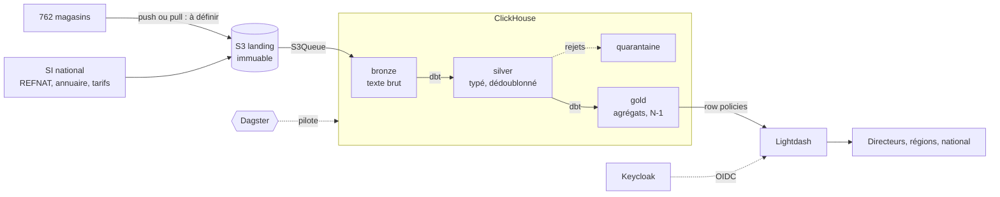
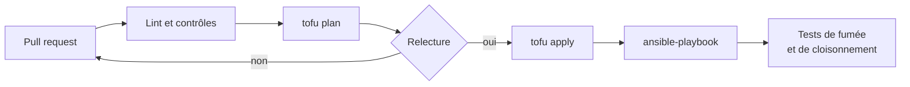

# Architecture cible

!!! abstract "En bref"
    - ClickHouse stocke, transforme et sert les données.
    - Dagster pilote dbt de 23 h à 6 h. Les données sont prêtes à 7 h 30.
    - Les row policies ClickHouse filtrent chaque requête, quel que soit l'outil.
    - Le reverse proxy est la seule machine visible depuis Internet.
    - OpenTofu crée l'infrastructure, Ansible la configure, SOPS chiffre les secrets.

## Contraintes qui pilotent les choix

| Contrainte | Valeur | Conséquence |
|---|---|---|
| Volume | 34 M lignes par jour, ×2,6 le 24 décembre, 5 ans d'historique | Moteur colonne, stockage froid sur S3 |
| Fenêtre | Traitement de 23 h à 6 h, données prêtes à **7 h 30** | Batch de nuit, publication atomique |
| Cloisonnement | Un adhérent voit son magasin seul. Agrégat publié seulement à partir de **5 magasins** | Filtrage dans la base, jamais dans l'outil de BI |
| Équipe | 2 personnes pour l'exploitation | Peu de composants, tout en code |
| Hébergement | Données en France ou dans l'UE | Fournisseur cloud français, 2 régions |
| Sobriété | Le client demande une solution mesurée en énergie et en coût | Un moteur, des VM petites, du froid sur S3 |

Sources : [volumétrie](../00-cadrage/reponses-client/volumetrie-et-contraintes.md), [cloisonnement](../00-cadrage/reponses-client/donnees-personnelles-et-cloisonnement.md), [hébergement](../00-cadrage/reponses-client/hebergement-et-securite.md).

## Vue d'ensemble

## Une nuit type

| Heure | Étape | En cas d'échec |
|---|---|---|
| 21 h – 22 h | Les caisses clôturent | — |
| 22 h – 23 h 30 | Les fichiers arrivent dans S3 `landing/` | Le fichier reste en landing, une alerte part |
| 23 h 30 | Dagster contrôle la complétude | Alerte « magasin absent » |
| 23 h 30 – 6 h | dbt construit silver puis `gold_new` | Dagster relance la partition magasin × jour |
| 6 h | Les tests dbt vérifient volumes, seuil de 5 magasins, étanchéité | La veille reste en ligne avec un bandeau |
| 6 h | `EXCHANGE TABLES` publie `gold_new` d'un seul coup | — |
| **7 h 30** | Les directeurs consultent | — |

## Couches de données

| Couche | Où | Contenu | Règle |
|---|---|---|---|
| **landing** | S3 | Fichier reçu, tel quel | Immuable : versionnement et object lock. Source de tout rejeu |
| **bronze** | ClickHouse | Colonnes en `String`, plus `_path` et `_file` | Aucune interprétation. Conserve l'encodage d'origine |
| **silver** | ClickHouse | Données typées, dédoublonnées, référentiels appliqués | Rejets en quarantaine avec leur motif |
| **gold** | ClickHouse | CA jour × magasin × rayon, comparaison N-1 | Publié seulement si les tests passent |

**Clé de tri** : `(magasin_id, date)`. Une requête d'un magasin lit environ 1/762 des données.

**Stockage froid** : ClickHouse déplace les données de plus de 13 mois sur S3.

## Ingestion

Le mode d'envoi n'est **pas encore choisi**. Les deux options gardent la même suite de traitement.

| | Push : le magasin envoie | Pull : Vibro va chercher |
|---|---|---|
| Secrets chez Vibro | Aucun accès aux systèmes des magasins | Accès à l'API de l'éditeur pour 762 magasins |
| Exposition | Un point d'entrée sur le reverse proxy (443) | Aucune entrée, flux sortant seul |
| Contrôle de l'adhérent | L'adhérent choisit ce qui part | Vibro lit ce que l'API permet |
| Logiciel de stock majoritaire | Export poussé par l'éditeur | Connecteur Dagster vers l'API |
| Autres magasins | Petit service à définir | Petit service à définir |

Premier critère à obtenir : ce que l'éditeur majoritaire sait faire.

**Quel que soit le mode, appliquer ces règles :**

1. Identifier chaque fichier par son empreinte `sha256`. Un renvoi ne crée pas de doublon.
2. Déclarer le format de chaque source (séparateur, encodage, en-tête). Ne jamais deviner les types.
3. Si un fichier est illisible, le rejeter entier et alerter. Les autres magasins continuent.
4. Si plus de 2 % des lignes sont rejetées, ne pas publier la journée de ce magasin.

## Cloisonnement

| Acteur | Voit | Ne voit pas |
|---|---|---|
| Adhérent | Son magasin au détail, sa marge | Tout autre magasin |
| Adhérent | Agrégats régionaux et nationaux de 5 magasins ou plus | Un agrégat de moins de 5 magasins |
| Région | Ses magasins au détail | La marge d'un magasin, les autres régions |
| National | Agrégats à toute maille | Un porteur de carte |

**Mécanisme :**

- Keycloak porte l'identité. Les groupes suivent la hiérarchie magasin, région, national.
- ClickHouse applique une **row policy** par rôle. SQL direct et exports subissent le même filtre.
- Le gold ne contient aucun agrégat de moins de 5 magasins (`HAVING uniq(magasin_id) >= 5`).
- Aucun tableau ne classe des magasins entre eux.
- Un test automatique vérifie que le magasin A ne lit rien du magasin B, à chaque livraison.

!!! warning "Règle posée par la direction juridique"
    Aucun affichage comparatif nominatif entre adhérents, quelle que soit la maille.

## Restitution

- Lightdash lit les métriques déclarées dans les modèles dbt. Chaque indicateur a une seule définition.
- Les écrans visent la tablette : une colonne, 3 à 5 indicateurs, filtres date, rayon et N-1.
- Cube s'ajoute seulement si un deuxième consommateur arrive (application mobile, API, export).

## Infrastructure

| Machine | Rôle | Remarque |
|---|---|---|
| `ch-1`, `ch-2` | ClickHouse et Keeper | Disque séparé pour Keeper |
| `keeper-3` | Arbitre du quorum Keeper | Petite VM |
| `orchestration` | Dagster et runner CI | Lance OpenTofu et Ansible |
| `restitution` | Traefik, Keycloak, Lightdash | **Seule IP publique** |
| `supervision` | Prometheus, Grafana, Loki | Alertes : magasin absent, rejets, fraîcheur |
| PostgreSQL managé | Métadonnées Dagster, Lightdash, Keycloak | Endpoint privé |
| Buckets S3 | `landing`, `froid`, `backups`, `tofu-state` | `backups` répliqué en région 2 |

**Réseau :**

- Seul le port 443 du reverse proxy est ouvert sur Internet.
- Les ports 9440 (ClickHouse), 9281 (Keeper) et 22 (SSH) restent dans le réseau privé.
- SSH vers les VM part seulement d'`orchestration`, où le runner lance Ansible.

### Diagrammes UML

Les sources sont les fichiers `.drawio` de ce dossier. Modifiez-les dans draw.io : le rendu de cette page suit.

=== "Déploiement"

    

=== "Infrastructure"

    

=== "Réseau"

    

=== "Gestion"

    

## Gestion de l'infrastructure

- OpenTofu crée les VM, disques, groupes de sécurité, buckets, PostgreSQL et DNS.
- Ansible installe et configure les logiciels. Son inventaire vient des sorties OpenTofu.
- SOPS + age chiffre les secrets dans le dépôt. La clé privée du runner reste sur `orchestration`.
- L'état OpenTofu est dans un bucket dédié, chiffré par OpenTofu.
- Le runner est auto-hébergé dans le réseau privé. Il n'exécute jamais une PR issue d'un fork.
- Chaque nuit, un `tofu plan` vérifie que l'infrastructure n'a pas dérivé.

!!! note "Amorçage"
    Le premier `tofu apply` part du poste d'un exploitant. Il crée le bucket d'état, le réseau et la VM du runner. Ensuite, tout passe par une pull request.

## Sauvegarde

| Élément | Protection | Reprise |
|---|---|---|
| `landing` | Versionnement, object lock | Source de reconstruction de toutes les couches |
| ClickHouse | `clickhouse-backup` vers `backups`, répliqué en région 2 | Restauration, ou rejeu depuis landing |
| PostgreSQL | Sauvegarde du fournisseur avec reprise à un instant donné | Restauration du fournisseur |
| Code, infrastructure, secrets | Git, chiffré par SOPS | Nouveau `tofu apply` puis Ansible |

Objectifs à valider avec le client : **RPO 24 h**, **RTO 4 à 8 h**. Tester une restauration chaque trimestre.

## Décisions

| Sujet | Choix | État |
|---|---|---|
| Moteur | ClickHouse, moteur unique | Décidé |
| Bronze | Table ClickHouse en `String`, pas de Parquet | Décidé |
| Orchestration | Dagster et dbt-clickhouse | Décidé |
| Restitution | Lightdash, Cube si un 2e consommateur arrive | Décidé |
| Cloisonnement | Row policies ClickHouse et seuil de 5 magasins | Décidé |
| Infrastructure | OpenTofu, Ansible, SOPS + age, runner auto-hébergé | Décidé |
| Ingestion | Push ou pull | **Ouvert** |
| Service pour les autres magasins | À définir | **Ouvert** |
| Fournisseur cloud | Français, 2 régions | **Ouvert** |

Chaque décision fait l'objet d'une fiche courte : contexte, options, choix, conséquences.

## À valider au POC

| Question | Critère de réussite |
|---|---|
| Le cloisonnement tient-il par toutes les voies (Lightdash, SQL, export) ? | Zéro fuite |
| La nuit du 24 décembre (×2,6) tient-elle dans la fenêtre ? | Gold publié avant 6 h, avec marge |
| Lightdash répond-il au pic de 7 h 30 ? | Cible proposée : moins de 2 s par tableau. Nombre d'utilisateurs simultanés à fixer avec le client |
| Le `sql_filter` de Lightdash fonctionne-t-il sur ClickHouse ? | Filtre appliqué à chaque requête |
| Quelle est la compression réelle ? | Mesure sur données du client |

!!! info "Ordre de grandeur"
    6 Go bruts par jour, compressés environ ×15, donnent environ 150 Go par an et moins de 1 To sur 5 ans. C'est une hypothèse, à mesurer.
