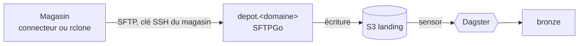

# Ingestion des sources

Ce document alimente la section 3.1 du dossier d'architecture technique (DAT). La vue d'ensemble est dans l'[architecture cible](architecture-cible.md).

!!! abstract "En bref"
    - Le magasin envoie ses fichiers à `depot.<domaine>`. Vibro ne se connecte jamais à un système du magasin.
    - Voie 1 : l'éditeur de caisse envoie chaque nuit les tickets et un manifeste.
    - Voie 2 : rclone copie le dossier d'export, pour les magasins sans connecteur éditeur.
    - La passerelle SFTPGo écrit dans le bucket `landing`. Un sensor Dagster charge chaque livraison dans le bronze.
    - Le directeur ne fait aucune action. L'alerte va à l'exploitant.

## Ce que les caisses produisent

| Caisse | Magasins | Sortie disponible |
|---|---|---|
| ALPHACAISSE | ~310 | Fichier CSV chaque nuit, sur un partage réseau du magasin |
| BETAPOS | ~260 | Base SQL Server locale, lisible depuis le réseau du magasin |
| GAMMASOFT | ~180 | Fichier XML chaque nuit. Interface JSON sur les ventes du jour |
| Éditeurs locaux | ~12 | Variable, parfois aucune sortie automatique |

Source : [cartographie §3.1](../00-cadrage/reponses-client/cartographie-si.md#31-encaissement).

Aucune de ces sorties n'est accessible depuis Internet. Un accès entrant au magasin exige l'accord de l'adhérent, et une partie des adhérents refuse cet accès.

## Principes

- Le magasin envoie. Vibro ne va jamais chercher les données.
- Le magasin connaît une seule adresse : `depot.<domaine>`.
- Le magasin envoie des fichiers bruts. Le central lit, contrôle et corrige.
- Le directeur ne fait aucune action. Cible : 0 minute par semaine.
- L'alerte va à l'exploitant, jamais au directeur.
- L'année 1 n'utilise ni flux continu ni lecture directe des bases. Le CDC sur BETAPOS demande de modifier la base de l'éditeur.

## Découplage

Quatre points séparent les magasins de la chaîne de traitement :

- **Le nom DNS** `depot.<domaine>`. Le magasin ne connaît ni le serveur, ni l'hébergeur, ni le bucket.
- **La passerelle** SFTPGo. Elle porte l'identité des magasins, et elle seule écrit dans `landing`.
- **Le landing** immuable. Il sépare la réception du traitement, et sert de source de rejeu.
- **Les adaptateurs** par format, au central. Un changement de format chez un éditeur ne touche aucun magasin.

## Trois voies

| Voie | Magasins | Fonctionnement | Installation et maintenance |
|---|---|---|---|
| 1. Connecteur éditeur | ALPHACAISSE, BETAPOS, GAMMASOFT : ~750 | L'éditeur envoie chaque nuit les tickets et un manifeste | L'éditeur, par son canal de mise à jour |
| 2. rclone | Magasin sans connecteur éditeur, ou version de caisse non maintenue | Une tâche planifiée copie le dossier d'export | L'informaticien local, au forfait payé par le national |
| 3. Exception | Éditeurs locaux : ~12 | Étude au cas par cas | À définir. Peut sortir de l'année 1 |

La voie 1 est la cible. Les éditeurs savent déjà envoyer des tickets la nuit : le flux F6 envoie les tickets des porteurs de carte à FIDELIS ([cartographie §4](../00-cadrage/reponses-client/cartographie-si.md#4-flux-existants)).

Le national négocie un accord-cadre avec chaque éditeur. L'adhérent active l'option. Le national paie l'éditeur et l'installation.

**L'accord-cadre engage l'éditeur à :**

- envoyer chaque nuit le détail des tickets et un manifeste ;
- retirer l'opérateur et remplacer l'identifiant de ticket avant l'envoi ;
- garder dans le magasin les livraisons des 7 derniers jours, et les renvoyer si l'envoi échoue ;
- renvoyer sur demande les jours passés, pour la reprise d'historique ;
- annoncer tout changement de format 3 mois avant ;
- livrer des fichiers de test en recette avant chaque déploiement ;
- corriger une livraison cassée dans un délai fixé.

## Point de dépôt

La passerelle SFTPGo (open source) reçoit les livraisons et les écrit dans le bucket `landing`. SFTPGo tourne sur la VM `depot`.

- `depot.<domaine>` est un nom DNS de Vibro, sur un domaine à définir. Si le serveur ou l'hébergeur change, modifiez le DNS. Les magasins ne changent rien.
- L'URL du bucket est dans la configuration de SFTPGo, et nulle part ailleurs.
- Ne donnez jamais d'identifiant S3 à un magasin. Si le fournisseur change, toutes les clés S3 changent aussi.
- Chaque magasin a un compte SFTPGo. Le compte liste et dépose sous `landing/<code_national>/` seulement.
- Le compte ne peut ni télécharger ni supprimer. Un fichier remplacé reste dans l'historique des versions du bucket.
- Le compte s'authentifie par clé SSH seulement. Aucun mot de passe.
- Si le port 22 sortant est fermé chez le magasin, le magasin envoie en HTTPS (443) par l'API de SFTPGo.
- Pendant une migration, gardez la clé d'hôte SSH. Sinon, les clients SFTP refusent le nouveau serveur.
- Utilisez un certificat TLS d'une autorité publique. N'épinglez aucun certificat dans un client.

## Livraison

Une livraison de la voie 1 contient un fichier de données et un manifeste JSON. Le manifeste arrive en dernier. Sans manifeste, la livraison est incomplète.

Chemin : `landing/<code_national>/<flux>/<date_metier>/<envoi>/`. `<envoi>` est l'horodatage UTC de l'envoi.

| Champ du manifeste | Contenu |
|---|---|
| `magasin` | Code du magasin chez l'éditeur |
| `flux` | `ventes` ou `stock` |
| `date_metier` | Jour des ventes, pas jour de l'envoi |
| `schema_version` | Version du format, par exemple `2.1` |
| `nb_tickets`, `nb_lignes`, `ca_ttc` | Totaux de contrôle |
| `sha256` | Empreinte du fichier de données |
| `connecteur` | Nom et version du connecteur |

Un schéma JSON dans le dépôt décrit le manifeste et chaque format de données. Ce schéma est le contrat avec les éditeurs.

La voie 2 n'a pas de manifeste. rclone copie le dossier d'export tel quel sous `landing/<code_national>/brut/`. rclone ne renvoie pas un fichier déjà copié. Un fichier manqué part au passage suivant.

## Règles de chargement

Un sensor Dagster détecte chaque livraison et la charge dans le bronze.

**Contrôlez la livraison (voie 1) :**

1. Si le manifeste est absent, attendez. N'ouvrez pas le fichier de données.
2. Si le code du manifeste ne correspond pas au compte dans le registre, rejetez la livraison et alertez.
3. Si l'empreinte du fichier diffère du manifeste, rejetez la livraison et alertez.
4. Si `schema_version` est inconnue, mettez la livraison en quarantaine. Les autres magasins continuent.
5. Si les totaux lus diffèrent des totaux du manifeste, mettez la livraison en quarantaine.

**Lisez les données (voies 1 et 2) :**

1. Si deux livraisons ont le même magasin, le même flux et la même date métier, gardez la plus récente.
2. Déclarez le format de chaque source : séparateur, encodage, en-tête. Ne devinez jamais un type.
3. Si la source livre du XML, convertissez le XML en JSON avant le bronze. ClickHouse ne lit pas le XML.
4. Comptez comme rejet une ligne illisible seulement. Une ligne sans code produit reste publiée en « non classé ».
5. Si plus de 2 % des lignes d'une journée sont illisibles, ne publiez pas cette journée du magasin. Le tableau du directeur indique la cause.
6. Dédoublonnez au niveau du ticket, jamais au niveau de la ligne. Deux lignes identiques peuvent être deux articles.
7. Comparez le volume de chaque magasin au même jour de la semaine précédente. Si la baisse dépasse 50 %, alertez l'exploitant. Seuil à régler au POC.

## Données personnelles

- Voie 1 : l'éditeur retire l'opérateur avant l'envoi. L'éditeur remplace l'identifiant de ticket par une empreinte HMAC. La clé HMAC reste dans le magasin.
- Voie 2 : le fichier brut contient l'opérateur et l'identifiant de ticket. Dagster retire ces deux champs au chargement. Le landing garde ces fichiers 13 mois au plus.
- L'empreinte permet de dédoublonner un ticket sans le relier à FIDELIS. La direction juridique doit valider ce choix.

## Registre des sources

Le registre des sources est un fichier YAML dans Git. Une entrée par magasin : code national, code éditeur, voie, clé SSH publique, état. La clé SSH est générée dans le magasin. Seule la clé publique sort du magasin. Le registre ne contient donc aucun secret. Ansible crée les comptes SFTPGo depuis le registre.

**Ajoutez un magasin :**

1. Faites signer à l'adhérent l'acte qui confie ses données au national.
2. Ajoutez le magasin au registre, à l'état `test`.
3. Demandez à l'éditeur d'activer l'option, ou à l'informaticien local d'installer rclone.
4. Faites un envoi de test en recette. Vérifiez les totaux et le code du magasin.
5. Passez le magasin à l'état `actif`.
6. Envoyez au directeur sa première restitution le lendemain.

**Changez la clé d'un magasin :**

1. Ajoutez la nouvelle clé publique au registre. Gardez l'ancienne clé.
2. Après le premier envoi réussi avec la nouvelle clé, retirez l'ancienne clé.

**Retirez un magasin :**

1. Passez le magasin à l'état `retiré`. Ansible supprime le compte SFTPGo.
2. Purgez les données selon la règle de la direction juridique.

Si un magasin change d'adhérent, le nouvel adhérent signe un nouvel acte. La direction juridique doit dire si le flux continue avant cette signature.

## Mises à jour

**Voie 1.** L'éditeur met à jour son connecteur par son canal habituel. L'accord-cadre impose une recette avant chaque déploiement.

**Voie 2.** rclone copie des fichiers seulement. La lecture et les corrections sont au central. Une correction de lecture ne touche donc aucun magasin.

- Fixez la version de rclone dans le paquet d'installation.
- Mettez rclone à jour pour un correctif de sécurité seulement. L'informaticien local fait la mise à jour, au forfait.
- Déployez par paliers : 5 magasins, puis 50, puis tous.
- Gardez la version précédente pour revenir en arrière.
- Installez des binaires signés seulement.

**Changement de format.** Un nouveau format arrive avec une nouvelle `schema_version`. La livraison part en quarantaine. L'exploitant ajoute l'adaptateur, puis rejoue la livraison depuis le landing.

## Supervision de la flotte

Chaque livraison réussie est un signal de vie du magasin. Le tableau de flotte, dans Grafana, montre pour chaque magasin :

- la dernière livraison réussie et le retard ;
- la voie, et la version du connecteur pour la voie 1 ;
- l'écart entre le manifeste et les données lues.

Si un magasin n'a rien livré au contrôle de complétude, l'alerte part chez l'exploitant.

Deux indicateurs suivent l'ingestion :

- le temps demandé au directeur, avec une cible de 0 minute par semaine ;
- la part des magasins livrés à l'heure sans intervention.

## Pannes

| Panne | Effet |
|---|---|
| Liaison du magasin coupée | Le connecteur ou rclone réessaie, garde les fichiers et les envoie la nuit suivante |
| Serveur du magasin éteint | Alerte au contrôle de complétude. Rattrapage au redémarrage |
| Fichier renvoyé ou corrigé | La livraison la plus récente remplace l'ancienne. Aucun doublon |
| Nouveau format chez l'éditeur | Quarantaine, alerte, nouvel adaptateur, rejeu |
| Clé SSH compromise | Retrait de cette clé seulement. Les autres magasins continuent |
| Changement de fournisseur S3 | Changement de la configuration SFTPGo seulement. Les magasins ne voient rien |
| Passerelle en panne | Les magasins gardent leurs fichiers et réessaient |

## À obtenir des éditeurs, par écrit

- Le connecteur FIDELIS peut-il envoyer tous les tickets, sans identifiant porteur, vers `depot.<domaine>` ?
- Quelles versions de caisse le permettent ? ALPHACAISSE a quatre versions majeures, dont une non maintenue.
- Pouvez-vous renvoyer les jours passés encore présents dans la caisse ?
- Pouvez-vous retirer l'opérateur et calculer l'empreinte du ticket avant l'envoi ?
- Quel est le coût par magasin, et qui le facture ?
