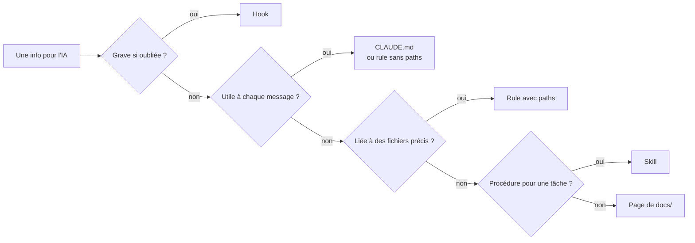

# Architecture du setup

## Arborescence cible

Une fois le setup activé, la racine du repo ressemblera à ceci :

```
CLAUDE.md                          # toujours chargé : carte du projet + règles absolues
CLAUDE.local.md                    # perso, gitignoré
.claude/
├── settings.json                  # partagé : permissions + hooks
├── settings.local.json            # perso, gitignoré
├── hooks/
│   └── guard.py                   # bloque l'écriture dans data/ et les secrets
├── rules/                         # conventions, chargées selon les fichiers touchés
│   ├── git.md                     # toujours
│   ├── data-securite.md           # toujours
│   ├── docs.md                    # docs/**
│   ├── python.md                  # ingestion/**, orchestration/**, tests/**
│   └── dbt-sql.md                 # transform/**
├── skills/                        # procédures, chargées quand la tâche correspond
│   ├── adr/SKILL.md
│   ├── adaptateur/SKILL.md
│   └── livrable/SKILL.md
└── agents/
    └── reviewer.md                # relecture dans un contexte isolé
docs/30-architecture/decisions/
├── index.md                       # résumé des décisions, importé dans CLAUDE.md
└── NNNN-titre.md                  # une ADR par décision
```

!!! note "Pourquoi `dot-claude` dans la proposition"
    Dans [`setup/`](composants.md), le dossier `.claude/` s'appelle `dot-claude/`. Claude Code découvre aussi les `.claude/` placés dans des sous-dossiers : avec le vrai nom, la proposition serait déjà active.

## Quel format pour quoi



| Format | Chargé quand | On y met | On n'y met pas |
|---|---|---|---|
| `CLAUDE.md` | Toujours, à chaque session | Carte du repo, commandes, lectures obligatoires, 5 à 10 règles absolues | Conventions détaillées, tutoriels |
| `.claude/rules/*.md` sans `paths:` | Toujours | Règles transverses courtes (git, sécurité) | Ce qui ne concerne qu'une techno |
| `.claude/rules/*.md` avec `paths:` | Quand l'IA lit ou modifie un fichier qui correspond | Conventions par techno ou par dossier | Procédures pas à pas |
| Skills | Quand la demande correspond à la `description`, ou via `/nom` | Procédures répétables, modèles, checklists | Règles permanentes |
| Agents | Lancés explicitement ou par délégation | Une tâche qui gagne à un contexte neuf (relecture) | Le travail courant |
| Hooks | Automatiquement, à chaque action concernée | Ce qui doit être **garanti** | Préférences de style |
| `docs/` | À la demande (lien depuis CLAUDE.md, une rule ou un skill) | Le fond : besoin, architecture, décisions | Des consignes pour l'IA |
| `CLAUDE.local.md` | Toujours, pour soi seul | Préférences perso (verbosité, langue des réponses) | Des règles d'équipe |

## Partagé ou personnel

| Partagé (versionné) | Personnel (gitignoré) |
|---|---|
| `CLAUDE.md`, `.claude/settings.json`, `.claude/rules/`, `.claude/skills/`, `.claude/agents/`, `.claude/hooks/` | `CLAUDE.local.md`, `.claude/settings.local.json` |

Un réglage personnel ne doit jamais contredire une règle d'équipe. S'il le fait, c'est que la règle est à rediscuter en PR.
