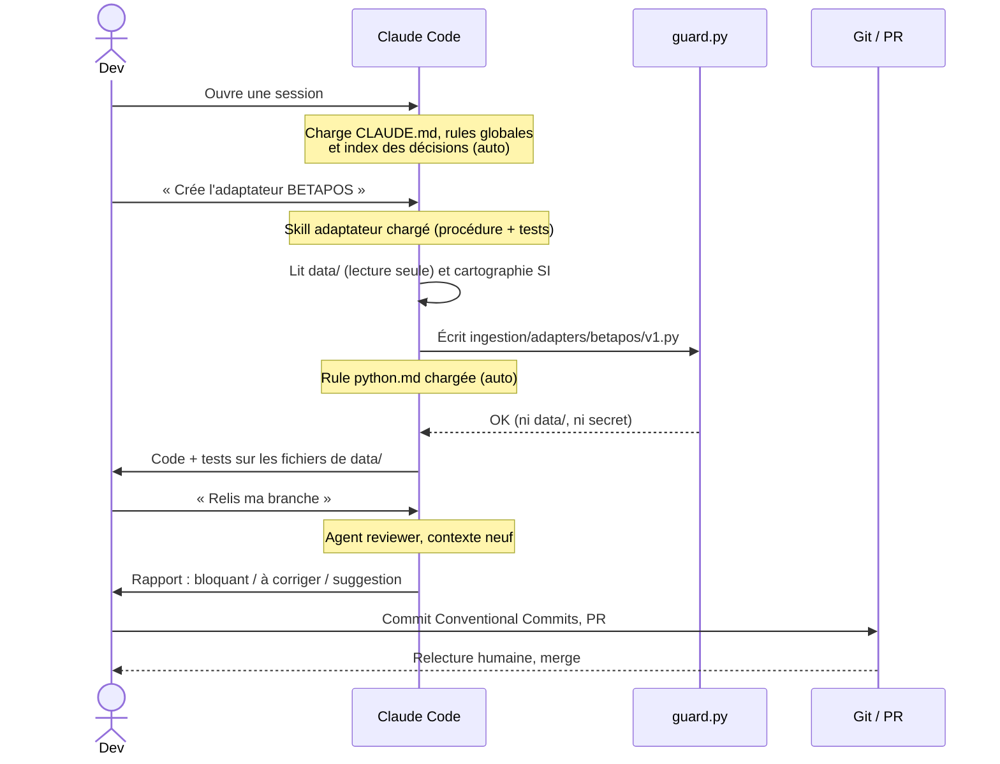

# Cycle de travail

## Une session type

## Les choix techniques passent par une ADR

Un choix nouveau (outil, format, découpage, règle de sécurité) passe toujours par le skill `adr` :

1. L'IA rédige une fiche en statut `proposed`, avec au moins deux options.
2. L'équipe tranche en PR.
3. La décision est ajoutée à la page de décisions, dans « Actées ».
4. Toutes les sessions suivantes, pour tous les devs, en héritent automatiquement.

C'est ce qui évite que l'IA de l'un propose Airflow pendant que celle de l'autre part sur Dagster.

## Gouvernance du setup

| Règle | Détail |
|---|---|
| Modification par PR | Toute modif de `CLAUDE.md` ou de `.claude/` passe par une PR, avec au moins un relecteur |
| Scope de commit `ai` | `feat(ai): add skill adr`, `fix(ai): narrow python rule paths` : les changements du setup sont visibles dans le changelog |
| Un problème = une règle | Quand l'IA refait la même erreur deux fois, on ajoute ou on précise une rule, pas une consigne orale |
| Élagage | Une règle qui ne sert plus est supprimée. Un `CLAUDE.md` qui grossit est un signal pour déplacer du contenu dans une rule ou un skill |
| Perso en local | Les préférences individuelles vont dans `CLAUDE.local.md`, jamais dans les fichiers partagés |
